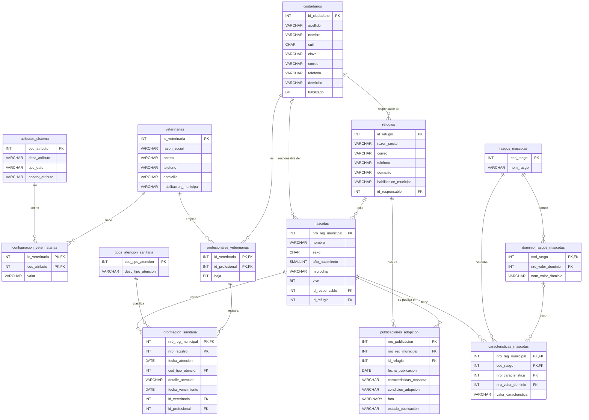

# DER – Mascotas Córdoba (modelo lógico implementado en SQL Server)

Base de datos: **CordobaMascotas** (Microsoft SQL Server). Se implementaron las **13 entidades** del modelo lógico entregado por la cátedra, con los mismos nombres de tablas y atributos. No se agregaron, quitaron ni renombraron tablas ni columnas. El modelo lógico no define tipos de datos ni nulabilidad: esas decisiones corresponden al modelo físico y se justifican tabla por tabla más abajo.

Si tu visor de Markdown soporta Mermaid, el mismo diagrama se ve acá (el nombre `configuracion_veterinatarias` está tal cual en el diagrama de la cátedra):

## Cómo leer el diagrama

- Notación de pata de gallo. `||` = exactamente uno, `|o` = cero o uno, `o{` = cero o muchos.
- **PK** = clave primaria, **FK** = clave foránea. Las relaciones identificantes (la FK integra la PK) son: `configuracion_veterinatarias`, `profesionales_veterinarias`, `dominio_rasgos_mascotas`, `caracteristicas_mascotas` e `informacion_sanitaria` (con `mascotas`).
- El "|" del lado del padre en el modelo de la cátedra se implementó como FK `NOT NULL`, y el "o|" como FK que admite `NULL`.

## Qué tablas usa cada requerimiento

| Requerimiento | Tablas |
|---|---|
| RF15 – Autenticar usuarios | `ciudadanos`, `refugios` |
| RF13 – Gestionar publicaciones de adopción | `publicaciones_adopcion`, `mascotas`, `refugios`, `caracteristicas_mascotas`, `rasgos_mascotas`, `dominio_rasgos_mascotas` |
| Resto del modelo (no se usa en este parcial) | `veterinarias`, `profesionales_veterinarias`, `configuracion_veterinatarias`, `atributos_sistema`, `informacion_sanitaria`, `tipos_atencion_sanitaria` |

## Detalle de cada tabla

### atributos_sistema
Atributos de configuración que usa el sistema (URL del servicio, tecnología, parámetros, API Key).

| Columna | Tipo | Restricciones | Justificación |
|---|---|---|---|
| `cod_atributo` | INT IDENTITY | PK | Clave sustituta autonumérica. |
| `desc_atributo` | VARCHAR(100) | NOT NULL |  |
| `tipo_dato` | VARCHAR(30) | NOT NULL | Indica cómo interpretar el valor. |
| `observ_atributo` | VARCHAR(255) | NULL | Observación libre, opcional. |

### veterinarias
Veterinarias habilitadas.

| Columna | Tipo | Restricciones | Justificación |
|---|---|---|---|
| `id_veterinaria` | INT IDENTITY | PK | Clave sustituta autonumérica. |
| `razon_social` | VARCHAR(100) | NOT NULL |  |
| `correo` | VARCHAR(100) | NOT NULL | Medio de contacto obligatorio. |
| `telefono` | VARCHAR(20) | NULL | Opcional: el correo ya es contacto obligatorio. |
| `domicilio` | VARCHAR(150) | NOT NULL |  |
| `habilitacion_municipal` | VARCHAR(30) | NOT NULL |  |

### configuracion_veterinatarias
Valor de cada atributo de configuración para cada veterinaria. El nombre se mantiene tal como figura en el diagrama.

| Columna | Tipo | Restricciones | Justificación |
|---|---|---|---|
| `id_veterinaria` | INT | PK, FK → veterinarias | Relación identificante. |
| `cod_atributo` | INT | PK, FK → atributos_sistema | Relación identificante. |
| `valor` | VARCHAR(255) | NOT NULL |  |

### ciudadanos
Personas del sistema. Se usa para el ingreso de los usuarios de refugios (RF15) y como profesionales de veterinarias.

| Columna | Tipo | Restricciones | Justificación |
|---|---|---|---|
| `id_ciudadano` | INT IDENTITY | PK | Clave sustituta autonumérica. |
| `apellido` | VARCHAR(50) | NOT NULL |  |
| `nombre` | VARCHAR(50) | NOT NULL |  |
| `cuil` | CHAR(11) | NOT NULL, UNIQUE | Longitud fija, sin guiones. Es el dato de login, por eso no puede repetirse. |
| `clave` | VARCHAR(100) | NOT NULL | Se guarda el hash SHA-256 (64 caracteres hexadecimales), nunca la contraseña en texto plano. |
| `correo` | VARCHAR(100) | NOT NULL |  |
| `telefono` | VARCHAR(20) | NULL | Opcional. |
| `domicilio` | VARCHAR(150) | NOT NULL |  |
| `habilitado` | BIT | NOT NULL, DEFAULT 1 | Permite bloquear el acceso sin borrar al ciudadano. |

### profesionales_veterinarias
Profesionales que trabajan en cada veterinaria.

| Columna | Tipo | Restricciones | Justificación |
|---|---|---|---|
| `id_veterinaria` | INT | PK, FK → veterinarias | Relación identificante. |
| `id_profesional` | INT | PK, FK → ciudadanos | El profesional es un ciudadano. |
| `baja` | BIT | NOT NULL, DEFAULT 0 | Baja lógica: no se elimina porque la información sanitaria ya cargada lo referencia. |

### refugios
Refugios de animales. El usuario que se autentica es el ciudadano responsable del refugio.

| Columna | Tipo | Restricciones | Justificación |
|---|---|---|---|
| `id_refugio` | INT IDENTITY | PK | Clave sustituta autonumérica. |
| `razon_social` | VARCHAR(100) | NOT NULL |  |
| `correo` | VARCHAR(100) | NOT NULL |  |
| `telefono` | VARCHAR(20) | NULL | Opcional. |
| `domicilio` | VARCHAR(150) | NOT NULL |  |
| `habilitacion_municipal` | VARCHAR(30) | NOT NULL |  |
| `id_responsable` | INT | NOT NULL, FK → ciudadanos | El "|" del lado de ciudadanos en el diagrama indica que es obligatorio. Es la relación que permite saber a qué refugio pertenece el usuario autenticado. |

### mascotas
Mascotas registradas en el programa municipal.

| Columna | Tipo | Restricciones | Justificación |
|---|---|---|---|
| `nro_reg_municipal` | INT IDENTITY | PK | El sistema es el programa municipal, por lo tanto es quien asigna el número de registro. |
| `nombre` | VARCHAR(50) | NOT NULL |  |
| `sexo` | CHAR(1) | NOT NULL, CHECK ('M','H') | M = macho, H = hembra. El CHECK evita valores inválidos. |
| `año_nacimiento` | SMALLINT | NULL | Solo el año: la publicación pide edad aproximada y en animales rescatados puede desconocerse. Se escribe entre corchetes en SQL por la ñ. |
| `microchip` | VARCHAR(20) | NULL | No todas las mascotas lo tienen. |
| `vive` | BIT | NOT NULL, DEFAULT 1 |  |
| `id_responsable` | INT | NULL, FK → ciudadanos | "o|" del lado padre en el diagrama: opcional. |
| `id_refugio` | INT | NULL, FK → refugios | "o|" del lado padre en el diagrama: opcional. Una mascota tiene un responsable ciudadano o está a cargo de un refugio. |

### rasgos_mascotas
Tipos de característica que puede tener una mascota (Especie, Raza, Pelaje, etc.).

| Columna | Tipo | Restricciones | Justificación |
|---|---|---|---|
| `cod_rasgo` | INT IDENTITY | PK | Clave sustituta autonumérica. |
| `nom_rasgo` | VARCHAR(50) | NOT NULL |  |

### dominio_rasgos_mascotas
Valores permitidos para cada rasgo (por ejemplo, Perro y Gato para Especie).

| Columna | Tipo | Restricciones | Justificación |
|---|---|---|---|
| `cod_rasgo` | INT | PK, FK → rasgos_mascotas | Relación identificante. |
| `nro_valor_dominio` | INT | PK | Sin IDENTITY: es un número de orden dentro de cada rasgo (el 1 de Especie no tiene relación con el 1 de Raza), y IDENTITY es global a la tabla. |
| `nom_valor_dominio` | VARCHAR(100) | NOT NULL |  |

### caracteristicas_mascotas
Valor de cada rasgo para cada mascota.

| Columna | Tipo | Restricciones | Justificación |
|---|---|---|---|
| `nro_reg_municipal` | INT | PK, FK → mascotas | Relación identificante. |
| `cod_rasgo` | INT | PK, FK → rasgos_mascotas | Relación identificante. También forma parte de la FK compuesta hacia dominio_rasgos_mascotas. |
| `nro_caracteristica` | INT | PK | Sin IDENTITY: número de orden dentro de la mascota y el rasgo (permite más de un valor para un mismo rasgo). |
| `nro_valor_dominio` | INT | NULL, FK compuesta (cod_rasgo, nro_valor_dominio) → dominio_rasgos_mascotas | Opcional ("o|" en el diagrama). Se completa si el rasgo tiene valores predefinidos; la FK compuesta garantiza que el valor pertenezca a ese rasgo. |
| `valor_caracteristica` | VARCHAR(100) | NULL | Para rasgos de valor libre. |

### tipos_atencion_sanitaria
Tipos de atención (Vacunación, Desparasitación, Esterilización, Castración).

| Columna | Tipo | Restricciones | Justificación |
|---|---|---|---|
| `cod_tipo_atencion` | INT IDENTITY | PK | Clave sustituta autonumérica. |
| `desc_tipo_atencion` | VARCHAR(100) | NOT NULL |  |

### informacion_sanitaria
Atenciones sanitarias registradas por profesionales.

| Columna | Tipo | Restricciones | Justificación |
|---|---|---|---|
| `nro_reg_municipal` | INT | PK, FK → mascotas | Relación identificante. |
| `nro_registro` | INT | PK | Sin IDENTITY: número de orden de la atención dentro de cada mascota. |
| `fecha_atencion` | DATE | NOT NULL | Solo interesa el día. |
| `cod_tipo_atencion` | INT | NOT NULL, FK → tipos_atencion_sanitaria |  |
| `detalle_atencion` | VARCHAR(500) | NULL | Opcional. |
| `fecha_vencimiento` | DATE | NULL | Solo aplica a vacunas y similares. |
| `id_veterinaria` | INT | NOT NULL, FK compuesta → profesionales_veterinarias |  |
| `id_profesional` | INT | NOT NULL, FK compuesta → profesionales_veterinarias |  |

### publicaciones_adopcion
Publicaciones de mascotas en adopción (RF13).

| Columna | Tipo | Restricciones | Justificación |
|---|---|---|---|
| `nro_publicacion` | INT IDENTITY | PK | Clave sustituta autonumérica. |
| `nro_reg_municipal` | INT | NOT NULL, FK → mascotas | Una publicación siempre es de una mascota. |
| `id_refugio` | INT | NOT NULL, FK → refugios | La publicación queda asociada al refugio del usuario autenticado. |
| `fecha_publicacion` | DATE | NOT NULL, DEFAULT fecha del día | Se completa sola al dar de alta. |
| `caracteristicas_mascota` | VARCHAR(500) | NOT NULL | Descripción general que se muestra en el listado. |
| `condicion_adopcion` | VARCHAR(500) | NOT NULL | Condiciones básicas de adopción (RF13). |
| `foto` | VARBINARY(MAX) | NOT NULL | La imagen se guarda dentro de SQL Server, como piden los requerimientos tecnológicos, sin depender de almacenamiento de archivos aparte. |
| `estado_publicacion` | VARCHAR(15) | NOT NULL, DEFAULT 'ACTIVA', CHECK | Solo admite ACTIVA, PAUSADA o FINALIZADA (los estados del RF13). |

## Criterios generales

- **Claves sustitutas autonuméricas (`IDENTITY`)** para las claves simples: el diagrama no indica un código externo.
- **Sin `IDENTITY`** en los números de orden que forman parte de una clave compuesta (`nro_valor_dominio`, `nro_caracteristica`, `nro_registro`), porque `IDENTITY` es global a la tabla y esos números son relativos a su padre.
- **`NOT NULL`** para los datos esenciales y **`NULL`** solo para los opcionales o los que pueden desconocerse.
- **`CHECK`** únicamente donde la consigna define un conjunto cerrado de valores (estados de la publicación) o donde el dominio es evidente (sexo).
- **`UNIQUE` sobre `cuil`**: es el dato de autenticación. Es la única restricción que no surge directamente del diagrama, y se puede quitar sin afectar el resto del modelo.
